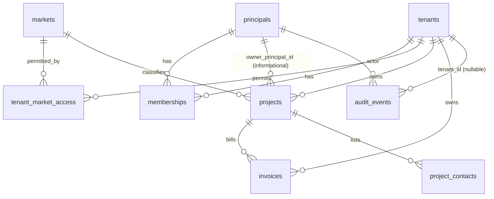

# Architecture

Status: **M0 design.** Implemented today: the oracle data and loaders, the fixtures and loader, the
error schema, the test harness and the tests. Everything else below is design for M1 onward.

## 1. Components

```text
 fixtures.toml ---> seed ---> database (SQLite for unit/lab, PostgreSQL for concurrency, M5)
                                  ^
                                  |  per-request re-read of principal, membership, tenant, market
 token (EdDSA JWT) --> FastAPI app (variant = patched | vulnerable)
                        gates 0..11 (deny by default) --> handler --> audit
                                  ^
        httpx.ASGITransport       |   (in-process, zero sockets)
                                  |
 oracle data (CSV/TOML) ---> case generator --> runner/executor --> state diff --> JSON + Markdown report
   (independent: never imports app code)                                            exit 0 / 1 / 2
```

* **Patched app** is the default and the only thing the production-style router mounts.
* **Vulnerable variant** (M3) lives in `lab/vulnerable/`, is never imported by the default app, and
  refuses to start unless `LAB_MODE=1`, the environment is not production and the bind address is
  loopback. Container-level network isolation is documented as the real boundary: an environment
  flag cannot enforce it (TL-16).
* **Oracle** is data plus a thin loader. It cannot call the application, so a bug cannot be mirrored
  into the judge.
* **Runner** (M4) compares status, response shape, visible fields, list totals and the database
  before/after, so a "403 after a write" is a violation.

## 2. Package layout and import rules

```text
src/tenantlab/
  schemas/errors.py          ProblemDetail, ErrorCode              (M0)
  oracle/                    matrix.py, catalog.py, data/*.csv|toml (M0)  case_generator, rules (M4)
  lab/fixtures/              fixtures.toml, loader.py               (M0)
  lab/patched/ lab/vulnerable/                                        (M2 / M3)
  api/  auth/  db/  config.py                                         (M1 onward)
  runner/  cli.py                                                     (M4)
```

| Package | May import | Must NOT import |
|---|---|---|
| `tenantlab.oracle` | stdlib, third-party, `tenantlab.schemas`, `tenantlab.lab.fixtures` | `api`, `auth`, `db`, `runner`, `lab.patched`, `lab.vulnerable` (enforced by test) |
| `tenantlab.api` (default router) | `auth`, `db`, `schemas`, `lab.patched` | `lab.vulnerable` (verified in a clean subprocess in M3) |
| `tenantlab.lab.vulnerable` | `schemas`, `db` | anything from `oracle` |

## 3. Request pipeline

Defined once in `oracle/data/gates.csv` and summarised in `docs/api-contract.md` s7 and
`docs/authorization-matrix.md` s2: transport limits, authenticate, principal status, tenant
membership, tenant state, resource scope, role/capability, market permit, input validation, quota,
state preconditions, action, audit. A request is denied at the first failing gate and every
non-2xx response is a `ProblemDetail`.

Cross-cutting rules: the server re-reads authority from the database on every request (no
authorization cache); request bodies are parsed only after the capability gate; the server
generates the request id; failures of a dependency fail **closed** (`503`, never allow).

## 4. Data model



Constraints (enforced in M1 migrations and verified in CI databases): primary and foreign keys;
`UNIQUE(principal_id, tenant_id)` on memberships; `UNIQUE(tenant_id, market_id)`; `amount_minor >= 0`;
status/role enumerations as CHECK constraints; foreign-key enforcement switched on for SQLite
(`PRAGMA foreign_keys=ON`). Project/invoice tenant coherence is **not** expressible as a plain
foreign key, so it is enforced in the service layer and tested (TL-07). Column definitions: spec s4.

## 5. Execution boundaries

* Tests and the demo run in-process over `httpx.ASGITransport`; no socket is opened.
* If a loopback listener is ever added, it binds `127.0.0.1` only.
* Nothing in this repository makes an outbound request except package installation and `pip-audit`.
* Migrations never run automatically at application start.
