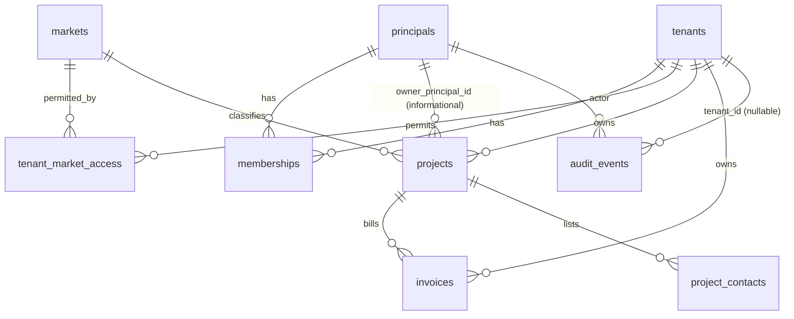

# Architecture

Status: **M2.** Implemented: the oracle data and loaders, fixtures, error schema and harness (M0);
settings, token verifier, database layer, route registry and gate pipeline (M1); the patched API:
all ten handlers, request parsing, paging, atomic write statements and audit (M2). Not yet built:
the vulnerable variant (M3), the runner and oracle engine (M4), PostgreSQL concurrency and CI (M5).

## 1. Components

```text
 fixtures.toml ---> seed ---> database (SQLite for unit/lab, PostgreSQL for concurrency, M5)
                                  ^
                                  |  per-request re-read of principal, membership, tenant, market
 token (EdDSA JWT) --> FastAPI app (variant = patched | vulnerable)
                        gates 0..11 (deny by default) --> handler --> audit
                                  ^
        httpx.ASGITransport       |   (in-process, zero sockets)
                                  |
 oracle data (CSV/TOML) ---> case generator --> runner/executor --> state diff --> JSON + Markdown report
   (independent: never imports app code)                                            exit 0 / 1 / 2
```

* **Patched app** is the default and the only thing the production-style router mounts.
* **Vulnerable variant** (M3) lives in `lab/vulnerable/`, is never imported by the default app, and
  refuses to start unless `LAB_MODE=1`, the environment is not production and the bind address is
  loopback. Container-level network isolation is documented as the real boundary: an environment
  flag cannot enforce it (TL-16).
* **Oracle** is data plus a thin loader. It cannot call the application, so a bug cannot be mirrored
  into the judge.
* **Runner** (M4) compares status, response shape, visible fields, list totals and the database
  before/after, so a "403 after a write" is a violation.

## 2. Package layout and import rules

```text
src/tenantlab/
  schemas/errors.py          ProblemDetail, ErrorCode              (M0)
  oracle/                    matrix.py, catalog.py, data/*.csv|toml (M0)  case_generator, rules (M4)
  lab/fixtures/              fixtures.toml, loader.py               (M0)
  config.py  ids.py          Settings (public material), strict UUID parsing        (M1)
  auth/                      tokens.py (EdDSA verifier), policy.py (own capability table) (M1)
  db/                        engine.py, models.py, migrate.py, seed.py, migrations/ (M1)
  api/                       app.py, routes.py, gates.py, middleware.py, problems.py,
                             handlers.py                                              (M1)
  lab/patched/               schemas.py (strict requests, response models), paging.py,
                             service.py (bounded reads, authority-checking writes)    (M2)
  lab/vulnerable/                                                                     (M3)
  runner/  cli.py                                                     (M4)
```

| Package | May import | Must NOT import |
|---|---|---|
| `tenantlab.oracle` | stdlib, third-party, `tenantlab.schemas`, `tenantlab.lab.fixtures` | `api`, `auth`, `db`, `runner`, `lab.patched`, `lab.vulnerable` (enforced by test) |
| `tenantlab.api`, `tenantlab.auth`, `tenantlab.db` | `schemas`, `lab.fixtures` (seed only), `lab.patched` (M2) | `oracle`, `runner`, `lab.vulnerable` (enforced by `test_app_independence.py`; subprocess check in M3) |
| `tenantlab.lab.vulnerable` | `schemas`, `db` | anything from `oracle` |

## 3. Request pipeline

Defined once in `oracle/data/gates.csv` and summarised in `docs/api-contract.md` s7 and
`docs/authorization-matrix.md` s2: transport limits, authenticate, principal status, tenant
membership, tenant state, resource scope, role/capability, market permit, input validation, quota,
state preconditions, action, audit. A request is denied at the first failing gate and every
non-2xx response is a `ProblemDetail`.

Gates 0-6 and the query-name part of gate 8 run for every route in
`api/routes.py` (the registry is the only way a route is mounted, so a route cannot skip a gate).
Gates 7-11 run inside the handlers (M2), because they need the body: media type and syntax, market
permit (create), body validation, quota, then one write statement that re-checks authority, with
the version and last-owner preconditions (gates 10-11). The request body is never read by gates 1-6.

Cross-cutting rules: the server re-reads authority from the database on every request (no
authorization cache); request bodies are parsed only after the capability gate; the server
generates the request id; failures of a dependency fail **closed** (`503`, never allow).

## 4. Data model



Constraints (enforced in M1 migrations and verified in CI databases): primary and foreign keys;
`UNIQUE(principal_id, tenant_id)` on memberships; `UNIQUE(tenant_id, market_id)`; `amount_minor >= 0`;
status/role enumerations as CHECK constraints; foreign-key enforcement switched on for SQLite
(`PRAGMA foreign_keys=ON`). Project/invoice tenant coherence is **not** expressible as a plain
foreign key, so it is enforced in the service layer and tested (TL-07). Column definitions: spec s4.

## 5. Execution boundaries

* Tests and the demo run in-process over `httpx.ASGITransport`; no socket is opened.
* If a loopback listener is ever added, it binds `127.0.0.1` only.
* Nothing in this repository makes an outbound request except package installation and `pip-audit`.
* Migrations never run automatically at application start.
